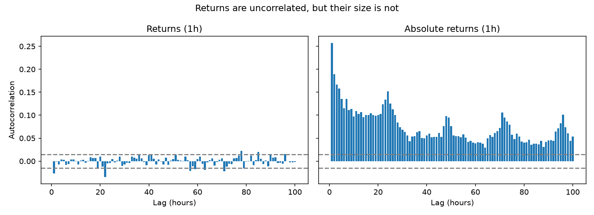
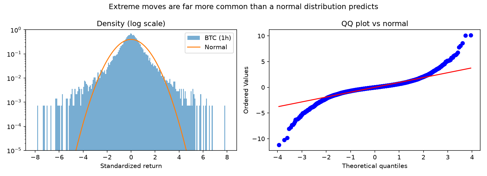

# Patterns of Bitcoin returns

Financial markets share a set of wellknown statistical patterns, from stocks to currencies. I wanted to know whether Bitcoin, a market that never closes and is split across dozens of exchanges, follows the same rules. Mostly it does, with one twist I didn't expect.

I used BTC/USDT prices from the Binance US public API: two years of hourly and daily data (October 2024 to october 2026) and ninety days of one-minute data. The end date is fixed, so rerunning the code reproduces the same numbers. One thing I had to deal with: Binance US was down for about nine hours at one point in the sample. I only compute returns between consecutive candles, so that outage doesn't show up as one giant fake return.

## What I found



The left panel shows that hourly returns are essentially uncorrelated. Knowing which way the price moved last hour tells you almost nothing about the next hour. The right panel tells a different story: the *size* of moves is strongly correlated, starting around 0.26 and still clearly above zero after 100 hours. Calm periods stay calm and turbulent periods stay turbulent, for days.

The twist is the bumps at 24, 48, 72 and 96 hours. Volatility rises and falls on a daily cycle, even though crypto trades around the clock. My guess is that it tracks the hours when traditional markets, especially US equities, are open. If so, it's a small sign of crypto becoming tied to traditional finance, which I want to test properly next.



Bitcoin's returns also have much fatter tails than a normal distribution. Hourly moves reach 8 to 10 standard deviations, which a normal model would treat as practically impossible. The tails thin out as you look at longer periods, just as in other markets, but they never disappear:

| Returns | Kurtosis (normal = 3) |
|---|---|
| 1-minute | 113.8 |
| Hourly | 12.9 |
| Daily | 7.7 |

These results also explain my earlier volatility forecasting project, where current volatility did almost all the work of predicting volatility a few minutes ahead. Seeing how persistent volatility is here, that result looks less like a quirk of my sample and more like a basic property of the market.

A few caveats. This is one exchange, and a fairly small one by global volume. Two years may not cover every kind of market regime. And kurtosis is a fragile statistic when tails are this heavy, since a handful of extreme moves can swing it a lot, so I'd read the one-minute figure as "very large" rather than a precise number.

## Running it

```bash
conda create -n btc-facts python=3.11 pandas numpy matplotlib scipy statsmodels requests -y
conda activate btc-facts
python src/fetch_data.py
python src/analysis.py
```

The first script downloads the data into `data/`, and the second makes the figures and summary table in `figures/`.